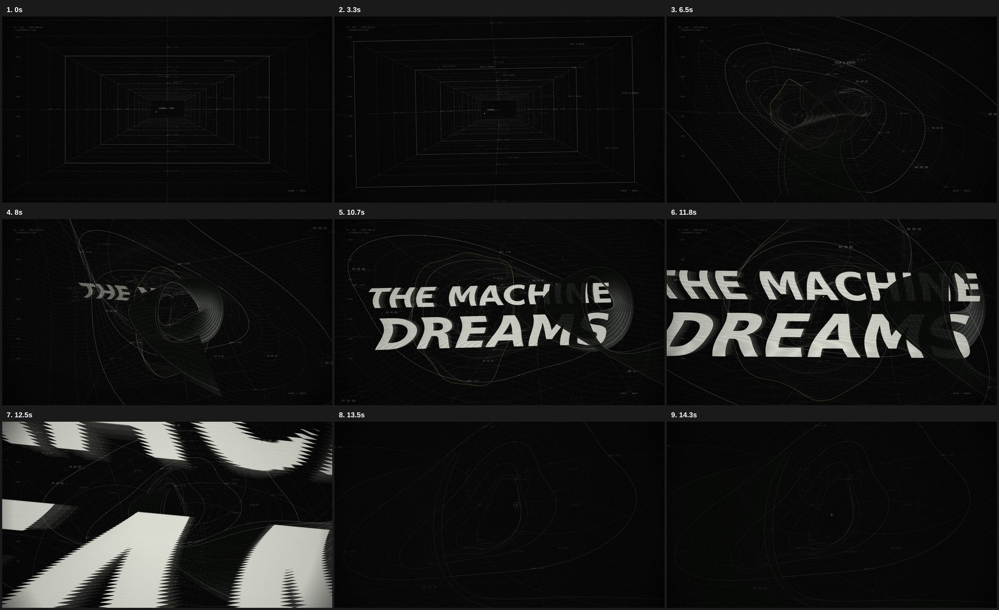

# THE MACHINE DREAMS

一台机器第一次做梦。15 秒连续镜头，由 HyperFrames + GSAP 驱动的程序化三维矢量空间。

**成片：[`output/THE_MACHINE_DREAMS.mp4`](output/THE_MACHINE_DREAMS.mp4)**

1920 × 1080 / 30 fps / 450 帧 / H.264 / AAC 立体声。无音乐、无摄影素材、无生成式静态图片。



## 预览与重渲染

需要 Node.js 22+、FFmpeg、Chromium/Chrome。项目固定 HyperFrames 0.8.198、GSAP 3.15.0，字体和 GSAP 浏览器运行时均已本地化。

```sh
npm ci
npm run dev
npm run check
npm run render
```

预览地址：`http://localhost:3002/#project/the-machine-dreams`。`npm run dev` 启动持久化 HyperFrames Studio；可直接播放、拖动时间线。Linux 的 `/usr/bin/chromium` 会自动识别；其他环境可设置 `HYPERFRAMES_BROWSER_PATH`。

```sh
npm run snapshot
npm run stop
```

声音已包含在项目中。如需重新合成：Python 3 + NumPy，运行 `npm run sound`。音效仅使用正弦振荡器、包络、固定种子噪声及微小节奏偏移。

## 文件

| 路径 | 内容 |
| --- | --- |
| `index.html` | 可直接由 HyperFrames 读取的完整合成，自动构建 |
| `src/film.js` | 镜头、几何、文字材质、残影和时钟 |
| `src/index.template.html` | 合成结构、音轨、尺寸与时长 |
| `scripts/build.cjs` | 将可编辑源码嵌入合成，供 HyperFrames 静态检查 |
| `scripts/sound.py` | 原创程序化音效 |
| `assets/` | 本地字体、GSAP、WAV 音轨 |
| `preview/` | 审查图、验证结果、成片逐帧指标 |
| `render-temp/` | 本地预览运行状态和渲染中间文件，不上传 Git |
| `output/` | 最终 MP4 |
| `DESIGN_NOTES.md` | 视觉概念、技术与抗幻灯片设计 |
| `REVIEW.md` | 自我审查、修订和验证边界 |

修改 `src/film.js` 后运行 `npm run build`，不要直接编辑构建产物 `index.html`。所有可见状态都可以按任意时间独立重建；不依赖上一帧、墙钟或在线素材。
