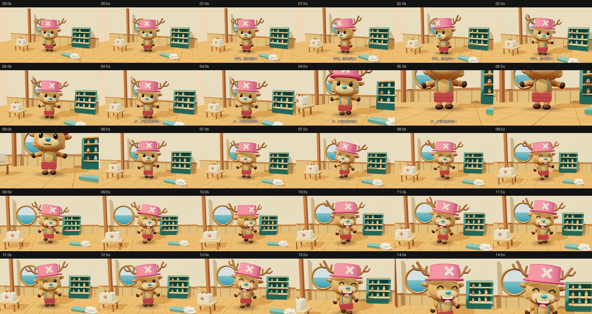

# 才没有高兴呢！ / CHOPPER

15 秒乔巴同人表演短片。


1920×1080 / 30fps / 450 帧 / H.264 + AAC。

**成片：[output/CHOPPER_NOT_HAPPY.mp4](output/CHOPPER_NOT_HAPPY.mp4)**

画外：“乔巴，你真厉害！”

乔巴努力否认，小蹄子却已经开始跳舞。

## 技术与运行

完整程序化 Three.js 角色与场景，GSAP 时间线，HyperFrames 正式渲染。字体、Three.js、GSAP、声音均在 `assets/` 本地保存，渲染不请求在线资源。

需要 Node.js 22+、FFmpeg 与 Chromium/Chrome：

```sh
npm ci
npm run dev
npm run check
npm run snapshot
npm run render
```

预览 URL 以命令打印结果为准，默认端口 3004。Linux 可自动使用 `/usr/bin/chromium`，其他位置可通过 `HYPERFRAMES_BROWSER_PATH` 指定。渲染脚本选择本机 OpenGL 路径；没有可用 OpenGL 的主机可通过 `node scripts/hyperframes.cjs render --no-browser-gpu --fps 30 --quality delivery --output output/CHOPPER_NOT_HAPPY.mp4` 使用软件后端。先在 `src/film.js` 修改，再运行 `npm run build` 生成 HyperFrames 可检查的 `index.html`。

- `src/film.js`：人物、场景、表情、骨架和摄影机。
- `src/index.template.html`：HyperFrames 根合成与音轨。
- `scripts/sound.py`：固定种子的海声、衣料、木蹄、瓶盖和声音混合。
- `scripts/voices.py`：两句普通中文合成配音，不模仿原声演员。已生成的声音文件直接包含在项目内。
- `SPEC.md` / `STORYBOARD.md`：表演与时间结构。
- `DESIGN_NOTES.md` / `REVIEW.md`：设计与审查记录。
- `preview/`：关键帧、完整成片检查结果。
- `output/`：最终 MP4 和参数校验信息。

如需重新生成配音，安装 `requirements-audio.txt` 并运行 `python scripts/voices.py`，再运行 `python scripts/sound.py`。配音生成需要网络，视频渲染不需要。仅重新混合音效时保留现有 MP3 即可。

## 创作说明

乔巴 / Tony Tony Chopper 为《ONE PIECE》角色，原作尾田荣一郎。本作是非官方同人短片。三维建模、布景、表演和音效为本项目制作；没有使用原动画画面或原声演员录音。
