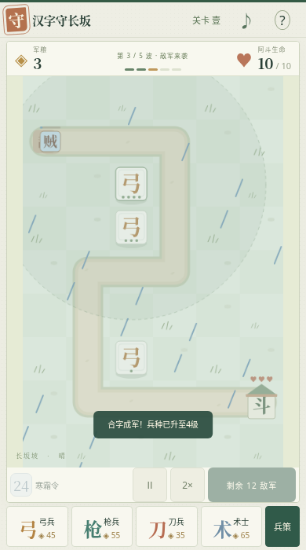

# 汉字守长坂

一字一兵，一笔一城。无广告、无付费、无 PK、无体力限制的单人汉字合成塔防。六张独立路线、5—9 波敌军、三星评价和逐关解锁；进度只保存在当前浏览器，不需要账号。

[在线游玩](https://hanhuanggg.github.io/mobile-lab/experiments/005-hanzi-changban/) · [返回陈列馆](../../)

## 游玩

选弓、枪、刀、术，再点击草地布阵。弓远射、枪穿甲、刀群伤、术减速。消灭敌军赚军粮，两个相同兵种、相同等级可以拖到一起合成；也可以点选后用军粮升级，最高四级；手机点右下角「军师／兵策」打开操作面板。点选守军再点空地可移动，撤回返还70%投入。灌木花20军粮清除，获得35军粮并释放土地。

每一波均由玩家主动开始，波间可不限时布阵。寒霜令造成全场伤害、减速，冷却24秒。第2、4波守住后分别得到「赵」「云」，拼齐后在空地召唤赵云；后续第6、8波还会掉落字牌。全程10命可获三星，剩6—9命两星，1—5命一星；通关即可解锁下一章，重玩不会覆盖更好的成绩。

记忆点：赵云既可以长期守城，也能被主动舍弃。战斗中点选赵云，选择「舍将护主」并确认，他会永久退出本局阵容，让阿斗恢复2命、全场敌军后退3格并受85伤害。一次召唤只有一次机会，不能反复撤回刷收益。

手机点击、拖动均可；最窄320px下六列棋盘每格仍超过44px。手机根据实际可视高度等比例缩放完整战场，将选兵和开始波次放在同一屏，浏览器工具栏改变高度时自动重排。关卡切换与重开在顶部「关卡」菜单里，升级和召将在「军师」面板里；打开面板自动暂停，返回后恢复原状态。桌面自动将同一张地图横向展开。键盘1—4选兵、Q释放寒霜、P暂停、Escape取消选择；聚焦战场后方向键选格、Enter/空格操作。切到后台自动暂停，开启减少动态效果时关闭敌军摇摆。

## 运行

在仓库根目录运行 `python3 -m http.server 8000 --bind 0.0.0.0`，访问 `/experiments/005-hanzi-changban/`。手机关卡菜单和桌面页头均保留返回陈列馆入口。原生 HTML/CSS/JavaScript，无构建、运行依赖、远程字体、图片或广告 SDK。

`core.js` 包含关卡、经济、战斗、合成和结算；`main.js` 负责输入、绘制、声音和界面。`window.Changban.snapshot()` 是只读浏览器测试观察接口，不提供修改游戏状态的入口。测试说明和真实结果见 `BROWSER_REVIEW.md`。

## 创作取舍

比较了三条方向：常规随机征兵对战（不符合去PK）、照搬固定炮塔闯关（缺少文字玩法）、汉字布阵加拼名将的单人战役。选择第三条，沿用易理解的汉字战斗表达，重新制作地图、美术、数值和程序。

Builder：先完成布阵→迎敌→补给→召将→结算→解锁的闭环。

Critic：最弱的一刻是波间反复补兵，因此波次由玩家掌控，增加合成、穿甲、减速、障碍补给，让选择影响防线。首关作为教学较宽容，后续需要持续投入；本版尚没有跨关科技树或更多名将。

Madman：把「名将越强越要一直留着」反转成「可以主动放弃强将救主」，通过舍将护主实现。玩家在第4波获得完整姓名后发现这一取舍；它是实际战斗规则，不是剧情按钮。
